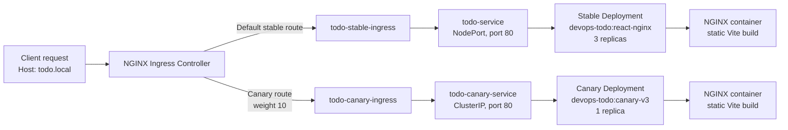

# Kubernetes-Based Canary Deployment of a React Todo Application

## 1. Title Page

**Project Title:** Kubernetes-Based Canary Deployment of a React Todo Application  
**Student Name:** ______________________________  
**Roll Number:** ______________________________  
**Course/Subject:** ______________________________  
**Department/Institution:** ______________________________  
**Faculty/Instructor:** ______________________________  
**Academic Year:** ______________________________  

**GitHub Repository:** [https://github.com/manndutiya23/devopslab-](https://github.com/manndutiya23/devopslab-)

---

## 2. Abstract

This project demonstrates a canary deployment approach for a React-based Todo application. The application is developed with React and Vite, packaged into a production container using a two-stage Docker build, and served by NGINX. Kubernetes resources provide separate stable and canary application workloads and Services. Two Ingress resources use the NGINX Ingress controller, with the canary Ingress configured to receive a declared 10% traffic weight.

The stable workload uses three replicas and the canary workload uses one replica. The canary frontend is identified in the application interface as **Todo App - Canary v3**, while the stable version in the repository history is identified as **Todo App - Kubernetes v2**. An observed sample of 100 HTTP requests to the Todo Ingress produced 91 stable responses and 9 canary responses, with no unrecognized responses. This is evidence that the configured routing worked for that sample; it is not a guarantee that every group of 100 requests will produce exactly a 90/10 split.

---

## 3. Introduction and Problem Statement

Modern applications need to be updated frequently, but releasing a new version to every user at once can increase operational risk. A defect in the new build may affect all users before the development or operations team has time to detect and correct it. A reliable deployment process therefore needs a way to introduce changes gradually and observe the new version under real traffic.

Canary deployment addresses this problem by running a new version alongside the existing stable version and routing only a controlled portion of traffic to it. If the canary behaves correctly, the release can be expanded or promoted. If problems are found, traffic can be returned to the stable version while the canary is investigated. In this project, Kubernetes Deployments and Services provide the workloads and internal endpoints, while NGINX Ingress resources define the stable route and the weighted canary route.

The problem addressed by this project is how to package a frontend application and expose stable and experimental versions concurrently without replacing the stable workload immediately. The repository implements the routing configuration needed for this demonstration. It does not contain an automated promotion controller, an automated rollback workflow, or a monitoring system.

---

## 4. Project Objectives

The project objectives are:

1. Containerize the React Todo application for production delivery.
2. Deploy the containerized frontend using Kubernetes resources.
3. Run stable and canary versions concurrently.
4. Route a controlled percentage of traffic to the canary version.
5. Validate the routing behavior using HTTP requests.
6. Demonstrate how a small frontend change can be introduced as a canary release.

The repository directly supports these objectives through the Dockerfile, the stable Deployment and Service, the canary Deployment and Service, and the two Ingress manifests. The observed HTTP sample provides validation of the routing behavior.

---

## 5. Technology Stack

| Technology | Role in the project | Evidence in the repository |
|---|---|---|
| React | Implements the interactive Todo user interface and application state | `package.json`, `src/App.jsx` |
| Vite | Provides the frontend build tool and development configuration | `package.json`, `vite.config.js` |
| JavaScript/JSX | Application implementation language and React component syntax | `src/App.jsx`, `src/main.jsx` |
| npm | Installs dependencies and runs the build and lint scripts | `package.json`, `Dockerfile` |
| Docker | Packages the Vite build into a portable container image | `Dockerfile` |
| Node.js 20 Alpine | Build-stage base image for installing dependencies and creating the production build | `Dockerfile` |
| NGINX Alpine | Runtime image that serves the generated static files on port 80 | `Dockerfile` |
| Kubernetes | Runs the stable and canary workloads and exposes them through Services | Kubernetes YAML manifests |
| NGINX Ingress | Routes requests for `todo.local` and applies the canary traffic annotation | `todo-stable-ingress.yaml`, `todo-canary-ingress.yaml` |
| Minikube | Intended local Kubernetes context for the project according to the project brief; exact Minikube commands are not recorded in the repository | To be confirmed from the local deployment workflow |

The repository does not contain a separate Minikube profile, cluster configuration, CI/CD pipeline, metrics stack, or monitoring configuration. These should not be treated as implemented features.

---

## 6. System Architecture

### 6.1 Architecture description

The application is built in two Docker stages:

1. A Node.js 20 Alpine build stage copies `package*.json`, runs `npm install`, copies the application source, and runs `npm run build`.
2. An NGINX Alpine runtime stage copies the generated `dist` directory to `/usr/share/nginx/html` and serves it on port 80.

Kubernetes then runs two separate application paths:

- **Stable path:** `todo-deployment` creates three Pods labelled `app: todo`; `todo-service` selects those Pods and exposes port 80.
- **Canary path:** `todo-canary-deployment` creates one Pod labelled `app: todo-canary`; `todo-canary-service` selects that Pod and exposes port 80 inside the cluster.
- **Ingress path:** Both Ingress resources use the `nginx` Ingress class and the host `todo.local`. The stable Ingress routes to `todo-service`. The canary Ingress routes to `todo-canary-service` and is marked as a canary with a weight of 10.

The repository contains only the Todo application’s stable and canary resources. No separate canary-demo Deployment, Service, or Ingress manifests are identifiable in the project, so the architecture below distinguishes the Todo canary resources from any unrelated demonstration resources that might exist in an external cluster.

### 6.2 Traffic flow



The diagram represents the declarative configuration in the manifests. The canary weight is a routing setting, not a statement that one of every ten requests is guaranteed to be canary traffic.

---

## 7. Application Overview

### 7.1 Implemented functionality

The application is a client-side Todo list. Its functionality, as implemented in `src/App.jsx`, includes:

- A default list containing three starter tasks.
- Adding a task through a form.
- Trimming the submitted text and ignoring empty submissions.
- Marking a task complete or incomplete with a checkbox.
- Removing an individual task.
- Clearing all completed tasks.
- Displaying counts for open, completed, and total tasks.
- Persisting the Todo list in browser `localStorage` using the key `devops.todo-items`.
- Restoring the saved list when the page loads, with fallback to the default list when there is no valid saved array.

The frontend is a static client-side application. The repository does not show a backend API, database, authentication system, or server-side Todo storage. Todo data is stored in the browser of the user accessing the application.

### 7.2 Stable V2 and Canary V3

The repository history verifies the version-label change:

- In the stable V2 version, the main heading was `Todo App - Kubernetes v2`.
- In the canary V3 version, the main heading is `Todo App - Canary v3`.

The final commit changes this heading in `src/App.jsx`; the Todo behavior, state handling, controls, persistence key, and descriptive subtitle remain unchanged in the recorded diff. Therefore, the application-level difference verifiable from the repository is primarily a visible release/version label. The canary image is named `devops-todo:canary-v3`, which aligns the container tag with the V3 frontend label.

---

## 8. Implementation and Deployment

### 8.1 Docker build process

The Dockerfile uses a multi-stage build:

```dockerfile
FROM node:20-alpine AS build
WORKDIR /app
COPY package*.json ./
RUN npm install
COPY . .
RUN npm run build
```

The runtime stage is:

```dockerfile
FROM nginx:alpine
COPY --from=build /app/dist /usr/share/nginx/html
EXPOSE 80
CMD ["nginx", "-g", "daemon off;"]
```

This separates build dependencies from the runtime image and serves the compiled frontend as static content. The stable Deployment refers to `devops-todo:react-nginx`, and the canary Deployment refers to `devops-todo:canary-v3`. Both images are configured with `imagePullPolicy: IfNotPresent`, which is suitable for an image already available to the target local cluster, but the exact image-loading command is not documented in the repository.

### 8.2 Stable Deployment and Service

`todo-deployment.yaml` defines:

- Deployment name: `todo-deployment`
- Replicas: 3
- Pod label: `app: todo`
- Container port: 80
- Image: `devops-todo:react-nginx`

`todo-service.yaml` defines:

- Service name: `todo-service`
- Selector: `app: todo`
- Service port 80 to target port 80
- Type: `NodePort`

The stable Service therefore selects only the Pods belonging to the stable Deployment.

### 8.3 Canary Deployment and Service

`todo-canary-deployment.yaml` defines:

- Deployment name: `todo-canary-deployment`
- Replicas: 1
- Pod label: `app: todo-canary`
- Container port: 80
- Image: `devops-todo:canary-v3`

`todo-canary-service.yaml` defines:

- Service name: `todo-canary-service`
- Selector: `app: todo-canary`
- Service port 80 to target port 80
- Type: `ClusterIP`

The distinct label and selector prevent stable traffic from being sent to the canary Pod through the stable Service.

### 8.4 Stable and canary Ingress resources

The stable Ingress is named `todo-stable-ingress`. It uses:

- Ingress class: `nginx`
- Host: `todo.local`
- Path: `/`
- Backend: `todo-service:80`

The canary Ingress is named `todo-canary-ingress`. It uses the same host and path, but its annotations are:

```yaml
nginx.ingress.kubernetes.io/canary: "true"
nginx.ingress.kubernetes.io/canary-weight: "10"
```

Its backend is `todo-canary-service:80`. These annotations instruct the NGINX Ingress controller to treat the second route as a canary route and assign it a configured weight of 10 relative to the stable route.

### 8.5 Access and build details

The application is built by the Dockerfile with `npm install` and `npm run build`, and the resulting files are served by NGINX on port 80. The manifests identify `todo.local` as the hostname. The exact local hostname-resolution method, Minikube tunnel or IP setup, image-loading command, and `kubectl` command sequence are not included in the tracked README or configuration; those operational details are therefore **to be confirmed** from the deployment session.

---

## 9. Testing and Results

### 9.1 Observed routing test

The observed test sent 100 HTTP requests to the Todo Ingress. The responses were classified as follows:

| Response classification | Count |
|---|---:|
| Stable responses | 91 |
| Canary responses | 9 |
| Unrecognized responses | 0 |
| **Total** | **100** |

A direct request to the canary Service also returned the V3 JavaScript asset `index-KJogKfqZ.js`. This confirms that the canary endpoint served the expected V3 frontend build in the observed environment.

### 9.2 Interpretation

The sample produced 9 canary responses out of 100 requests, or 9%, which is close to the declared 10% canary weight. It demonstrates that:

- Both stable and canary application paths were reachable.
- Requests to the shared Todo Ingress were classified into stable and canary responses.
- The canary path served the V3 frontend asset.
- No response in the observed sample was unrecognized.

This result is an observed sample, not a guarantee of an exact 90/10 split. Weighted routing can vary across samples because of request selection, controller behavior, connection handling, and other runtime factors. The test does not prove zero downtime, production-scale reliability, performance under load, security, persistent data sharing, or automated rollback. No literal zero-downtime claim is made because the repository does not provide availability measurements or a controlled failure test.

The repository does not retain a formal automated test script for the 100-request experiment. The exact command used to generate and classify those requests is **to be confirmed** if it is required for reproducibility.

---

## 10. Canary Release, Promotion, and Rollback

### 10.1 Release concept

A canary release starts the new version beside the stable version, sends a limited amount of traffic to the new version, and uses the observed behavior to decide whether to expand the release. This project represents that concept with separate Deployments, separate Services, and an NGINX Ingress canary weight.

### 10.2 Promotion

The repository does not contain a promotion script, a progressive delivery controller, a second traffic stage, or a manifest change that switches all traffic to the canary. Promotion is therefore not implemented as an automated or documented project feature. A possible future promotion process would first validate the canary, then update the stable image and/or Ingress configuration through a controlled, reviewable deployment change.

### 10.3 Rollback

The repository does not contain an automated rollback script or recorded rollback procedure for this Todo deployment. A possible future rollback would stop or scale down the canary and remove or disable its canary Ingress route, while preserving the stable Deployment. Exact rollback commands are **to be confirmed** before being used in an operational environment.

---

## 11. Challenges and Resolutions

The following points are supported by the repository history and manifests:

### 11.1 Version and image alignment

The final application heading changed from `Todo App - Kubernetes v2` to `Todo App - Canary v3`, and the canary Deployment uses the image tag `devops-todo:canary-v3`. Aligning the visible application label and canary image tag makes the canary easier to identify during testing.

### 11.2 Stable and canary routing separation

The stable and canary resources use different labels and selectors: `app: todo` for stable and `app: todo-canary` for canary. This avoids accidentally selecting the canary Pod through the stable Service. The Ingress backends also point to different Services.

### 11.3 Container and Service ports

The Dockerfile exposes port 80, both Deployments declare container port 80, and both Services target port 80. This consistent port mapping removes a common source of failed routing between the Ingress, Service, and NGINX container.

### 11.4 Dependency and lockfile state

The project includes `package-lock.json`, and the Dockerfile copies `package*.json` before running `npm install`. The repository history shows a final lockfile update, but it does not document a specific installation failure or its resolution. Any claim about a particular package-installation incident is therefore **to be confirmed** rather than presented as a completed troubleshooting event.

### 11.5 Evidence boundaries

The repository includes experiment documents, but their readable content does not provide a complete Todo-specific deployment runbook. Consequently, exact Minikube setup, image-loading, Ingress-controller enablement, and request-classification commands are not asserted as repository-verified commands.

---

## 12. Limitations and Future Scope

The current implementation is a focused demonstration rather than a complete production release system. Suitable future work includes:

1. **Automated CI/CD:** Build, lint, test, tag, and publish images automatically after approved changes.
2. **Image registry integration:** Use immutable registry references or digests instead of relying on locally available image tags.
3. **Progressive traffic stages:** Move from a small canary percentage to larger stages such as 10%, 25%, 50%, and 100% after validation.
4. **Automated health validation:** Add readiness and liveness probes and define rollout health checks.
5. **Monitoring and alerting:** Collect request counts, error rates, latency, and stable-versus-canary comparisons.
6. **Automated promotion and rollback:** Use a documented controller or pipeline to promote a healthy canary and revert an unhealthy release.
7. **Reproducible test tooling:** Store the HTTP request and response-classification script with the project.
8. **Frontend test coverage:** Add component or browser tests for adding, completing, removing, clearing, and persisting Todo items.
9. **Production ingress hardening:** Add TLS, explicit resource limits, security settings, and environment-specific configuration.
10. **Data-service evolution:** If shared Todo data is required, introduce a backend and persistent storage rather than browser-only `localStorage`.

All items in this section are future work unless separately implemented outside the files inspected for this report.

---

## 13. Conclusion

This project demonstrates the essential structure of a Kubernetes canary deployment for a React Todo frontend. The application is compiled with Vite, packaged with a multi-stage Dockerfile, and served by NGINX. Kubernetes maintains separate stable and canary workloads, and NGINX Ingress uses a canary annotation with a configured weight of 10.

The observed routing sample of 91 stable responses and 9 canary responses from 100 requests provides practical evidence that both versions were reachable through the Todo Ingress and that the canary received approximately the intended share of traffic. The direct canary request returning `index-KJogKfqZ.js` further identifies the served canary frontend build. At the same time, the project correctly remains a demonstration: promotion, rollback, monitoring, CI/CD, and formal production availability validation are not implemented in the inspected repository.

---

## 14. References

### Project reference

- GitHub repository: [https://github.com/manndutiya23/devopslab-](https://github.com/manndutiya23/devopslab-)

### Official technical references

The following official documentation topics are relevant to the technologies explicitly used in the project:

- React documentation: [https://react.dev/](https://react.dev/)
- Vite documentation: [https://vite.dev/guide/](https://vite.dev/guide/)
- Docker documentation: [https://docs.docker.com/](https://docs.docker.com/)
- Kubernetes documentation: [https://kubernetes.io/docs/](https://kubernetes.io/docs/)
- Kubernetes Deployments: [https://kubernetes.io/docs/concepts/workloads/controllers/deployment/](https://kubernetes.io/docs/concepts/workloads/controllers/deployment/)
- Kubernetes Services: [https://kubernetes.io/docs/concepts/services-networking/service/](https://kubernetes.io/docs/concepts/services-networking/service/)
- Kubernetes Ingress: [https://kubernetes.io/docs/concepts/services-networking/ingress/](https://kubernetes.io/docs/concepts/services-networking/ingress/)
- Kubernetes NGINX Ingress canary annotations: [https://kubernetes.github.io/ingress-nginx/user-guide/nginx-configuration/annotations/#canary](https://kubernetes.github.io/ingress-nginx/user-guide/nginx-configuration/annotations/#canary)
- Minikube documentation: [https://minikube.sigs.k8s.io/docs/](https://minikube.sigs.k8s.io/docs/)

The external documentation links explain the technologies; they are not evidence that every possible feature of those technologies is configured in this repository.

---

## 15. Appendix

### Appendix A: Relevant project files

| File | Purpose |
|---|---|
| `src/App.jsx` | React Todo component, state logic, persistence, and V2/V3 heading |
| `src/main.jsx` | React application entry point |
| `src/App.css` | Todo card, form, list, button, and responsive styling |
| `src/index.css` | Global layout and typography styles |
| `package.json` | Project metadata, dependencies, and npm scripts |
| `package-lock.json` | Locked npm dependency resolution |
| `vite.config.js` | Vite configuration with the React plugin |
| `Dockerfile` | Multi-stage frontend build and NGINX runtime image |
| `todo-deployment.yaml` | Stable Kubernetes Deployment with three replicas |
| `todo-service.yaml` | Stable Kubernetes NodePort Service |
| `todo-canary-deployment.yaml` | Canary Kubernetes Deployment with one replica |
| `todo-canary-service.yaml` | Canary Kubernetes ClusterIP Service |
| `todo-stable-ingress.yaml` | Stable `todo.local` Ingress route |
| `todo-canary-ingress.yaml` | Canary `todo.local` Ingress route and 10% weight |
| `README.md` | Vite starter README; it does not contain a complete Todo deployment runbook |

### Appendix B: Commands identifiable from the inspected project

The following commands are directly supported by the project files:

```bash
npm install
npm run build
npm run lint
```

`npm install` and `npm run build` are executed by the Dockerfile. `npm run lint` is defined in `package.json`.

The following operational actions are represented by the manifest files, but their exact commands were not recorded in the repository and should be confirmed before inclusion in a reproducible runbook:

```text
Build/tag the stable and canary Docker images: to be confirmed
Load the images into the local Kubernetes environment: to be confirmed
Apply the Kubernetes manifests: to be confirmed
Configure local access to todo.local: to be confirmed
Run the 100-request routing test: to be confirmed
Inspect the stable and canary responses: to be confirmed
```

### Appendix C: Verified configuration summary

| Area | Verified value |
|---|---|
| Stable replicas | 3 |
| Canary replicas | 1 |
| Stable image reference | `devops-todo:react-nginx` |
| Canary image reference | `devops-todo:canary-v3` |
| Container and target ports | 80 |
| Stable Service type | `NodePort` |
| Canary Service type | `ClusterIP` |
| Ingress host | `todo.local` |
| Ingress class | `nginx` |
| Canary weight annotation | `10` |
| Observed HTTP sample | 91 stable, 9 canary, 0 unrecognized out of 100 |
| Direct canary asset | `index-KJogKfqZ.js` |

